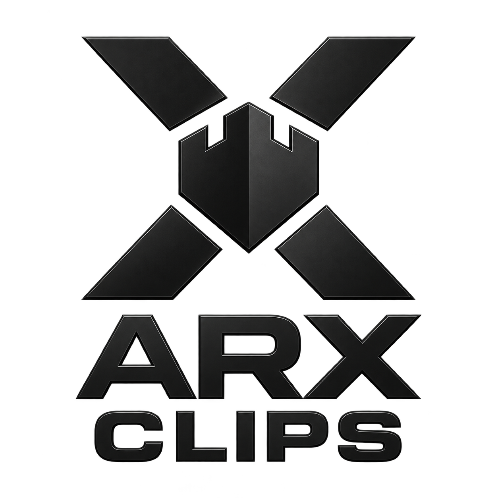

<p align="center">
  
</p>

<h1 align="center">Arx Clips</h1>

<p align="center">
  Private, self-hosted AI video clipping for turning long recordings into editable vertical clips.
</p>

<p align="center">
  <a href="LICENSE"></a>
  <a href="https://clips.arxsable.ai"></a>
  <a href="docs/README.md"></a>
</p>

Arx Clips accepts uploaded video, transcribes it, proposes promising moments, scores candidates, creates face-aware vertical crops, adds word-synced captions, and exports platform-ready clips. The production deployment is private and requires an authorized account.

## Production

- Application: [clips.arxsable.ai](https://clips.arxsable.ai)
- API: `clips-api.arxsable.ai`
- Deployment: Docker Compose project `supoclip` under `/opt/supoclip` on the shared Helsinki host
- Operations: use `ops/deploy.sh`; do not run `docker compose down -v`

The internal deployment identifiers retain their historical names for compatibility with persisted volumes, database credentials, queues, API headers, and systemd units. They are not the customer-facing product name.

## Features

- AI-assisted clip discovery and scoring
- Face-aware 9:16 reframing
- Word-synced captions and editable templates
- Built-in clip editor and social export presets
- Configurable transcription and language-model providers
- Private file uploads with durable media storage
- REST API and optional MCP integration

File uploads are operational. YouTube link imports currently remain unavailable because YouTube challenges the server-side downloader; the application reports that state directly instead of presenting link import as healthy.

## Development

Use the guides in [`docs/`](docs/README.md) for architecture, configuration, API, testing, and troubleshooting. Production development, dependency installation, builds, tests, migrations, and runtime operations are performed on the Helsinki server through SSH.

```bash
make test
```

## License

Arx Clips is distributed under the [AGPL-3.0 License](LICENSE). Copyright and contribution history remain preserved in the repository history.
